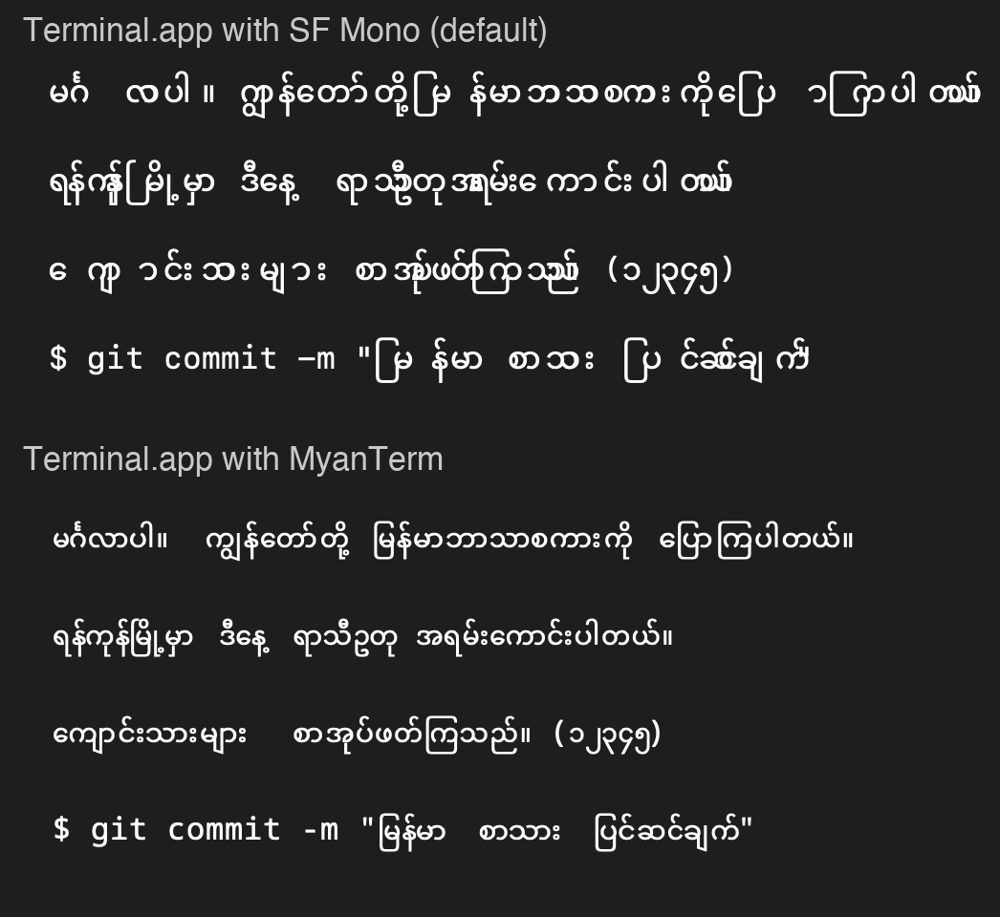

# MyanTerm

A monospace font that renders Burmese (Myanmar script) correctly and naturally in macOS Terminal.app.

macOS Terminal မှာ မြန်မာစာကို မှန်မှန်ကန်ကန်၊ သဘာဝကျကျ ပြသပေးတဲ့ ဖောင့်။



## Install

1. Download `MyanTerm-1.3.0.zip` from [Releases](../../releases) and unzip it.
2. Double-click `Install MyanTerm.command`. The first time, macOS may block it: right-click it, choose Open, then Open again.
   Or, in Terminal: `cd MyanTerm-1.3.0 && ./install.sh`

The installer:

- copies `MyanTerm-Regular.ttf` and `MyanTerm-Bold.ttf` into `~/Library/Fonts`
- copies a ready-made zsh into `~/.local/myanterm-zsh` (see below)
- adds a Terminal profile named **MyanTerm** that pins everything Burmese depends on: MyanTerm 13 pt, standard character spacing, UTF-8 encoding and locale, and that zsh as the login shell; your other profiles are not changed
- asks whether every Terminal window should use MyanTerm. If yes, MyanTerm becomes the default profile and Terminal > Settings > General > "Shells open with" is set to that zsh, so typing Burmese works in windows of any profile (both can be changed back in Terminal > Settings)
- checks that your Terminal measures Burmese the way the font expects

Then quit Terminal (Command-Q) and open it again. Windows that were open during the install keep the old shell, and after an upgrade Terminal keeps the old font in memory, until it restarts.

Options: `--default` / `--no-default` (skip the question), `--no-zsh` (font and profile only).

To remove everything: `./uninstall.sh`.

## Typing Burmese at the prompt

The font fixes how Burmese is drawn. Typing and editing Burmese in a command line also depends on the shell: zsh counts the spacing vowel signs and medials (ာ ေ ျ ြ း) as zero columns wide while Terminal gives each one a column, so with the stock zsh the cursor drifts and letters are left behind while you type.

The installer therefore sets up zsh 5.9.2 built with a small patch ([zsh/](zsh)) that makes zsh use Terminal's widths. It is one universal file (Apple silicon and Intel, macOS 11 or later), needs no Xcode tools and reads the same `/etc/zshrc` and your `~/.zshrc` as `/bin/zsh`. Terminal runs it in MyanTerm windows and, if you chose to use MyanTerm in every window, in all windows. Your login shell and `$SHELL` stay `/bin/zsh`. If your login shell is not zsh, the installer skips this part.

If typed Burmese repeats letters or piles up, that window is running `/bin/zsh`. To check a window, run `s=ကျေး; echo ${(m)#s}`: it prints 4 with MyanTerm's zsh and 1 with `/bin/zsh`.

## How it works

Terminal.app draws text cell by cell: every Burmese letter and every spacing vowel sign or medial gets one cell, and non-spacing marks get none. It shapes each row with Core Text and then places each glyph at the cell of the character it came from, ignoring the font's own spacing. Normal Burmese fonts rely on the text engine reordering ေ and ြ in front of the consonant and positioning marks freely, which breaks under that grid.

MyanTerm works with the grid instead:

- The font has no Myanmar OpenType script, so Core Text keeps glyphs in typed order and Terminal's placement is predictable.
- Every Burmese syllable (about 7,000, chosen by frequency in large Burmese corpora) is a single ligature glyph drawn from the real Noto Sans Myanmar shaping: reordering, medial widths, kinzi, stacked consonants and mark positions are exactly as in normal Burmese typography.
- Syllables are laid out proportionally, not one per cell. Each common syllable glyph exists in many copies shifted by small steps, and a contextual substitution picks the copy that continues where the previous syllable's natural spacing ended. Text can run a few cells ahead of or behind the grid; the difference is absorbed at the next space. Brackets, quotes and zero-width characters next to Burmese join this flow; English text and code are not affected.
- Burmese typed in a non-standard order is drawn like the standard spelling where the order is unambiguous: ေ or ြ typed before the consonant (visual order, a Zawgyi-era habit) and swapped marks such as ုိ for ို or ့် for ့်.
- Uncommon sequences fall back to per-character glyphs that are positioned to stay readable.

## Limits

- Made for macOS Terminal.app. Other terminals (iTerm2, Ghostty, kitty, ...) lay out text differently.
- Built and tested on macOS 27 with Terminal 2.15. The installer checks the cell widths on your system and warns if they differ.
- Spacing is tuned for 13 pt, the profile's size (26 pt is also exact). Terminal rounds its cell width to a whole point, so at other sizes Burmese comes out slightly looser or tighter.
- Spaces between Burmese phrases are sometimes wider than one cell: that is where the extra room goes when a phrase is narrower than the cells Terminal reserves for it.
- Programs that do their own width calculation (for example some full-screen tools) may still disagree with Terminal about where Burmese text ends.
- Zawgyi-encoded text is a different encoding and is not supported. Visual-order typing is ambiguous after a syllable without a vowel (ဥပေဒ can mean ဥ+ပေ+ဒ), so such text shows the standard reading, as in every other app; type with a Unicode keyboard in standard order to avoid it.

## Building from source

```sh
tools/build_all.sh            # creates fonts/MyanTerm-*.ttf and MyanTerm.terminal
tools/build_all.sh --install  # also copies the fonts into ~/Library/Fonts
```

Needs Python 3; the script installs fontTools and uharfbuzz into a local `.venv`. The bundled zsh is built with `zsh/build-portable.sh` (needs Xcode Command Line Tools). Sources: `src/` (Noto Sans Mono and Noto Sans Myanmar), `data/corpus_counts.tsv` (syllable frequencies from Burmese Wikipedia, XL-Sum, HPLT, FLORES-200, Tatoeba and other Burmese text), `tools/` (segmenter, syllable list, font builder).

## License

The fonts are licensed under the [SIL Open Font License 1.1](OFL.txt) and are derived from [Noto Sans Mono](https://github.com/notofonts/latin-greek-cyrillic) and [Noto Sans Myanmar](https://github.com/notofonts/myanmar). Installer and tools: MIT. The zsh patch follows the zsh license. See [LICENSE](LICENSE).
